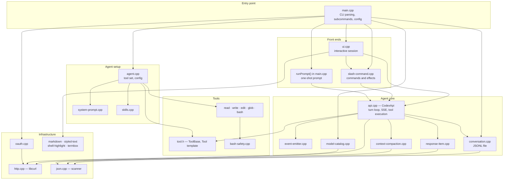
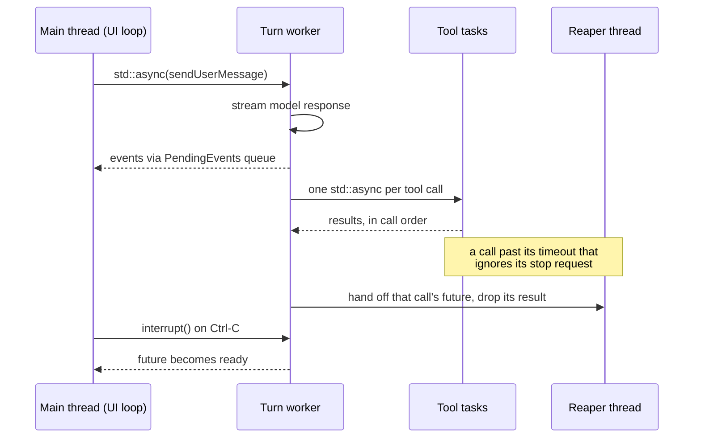

# Architecture

This page describes how the MicroCodex sources fit together: which module owns
what, which threads run at the same time, and the rules the code follows
everywhere. Later pages zoom into single parts:
[turn lifecycle](turn-lifecycle.md), [conversation state](conversation-state.md),
[context compaction](context-compaction.md), [tools](tools.md) and the
[terminal UI](terminal-ui.md).

## What MicroCodex is

MicroCodex is a single C++23 executable. It is a client for the Codex
Responses API: it sends the conversation to the model, streams the reply,
runs the tool calls the model asks for on the local machine, and repeats until
the model answers without calling a tool. Everything else (the terminal UI,
saved conversations, login) is built around that loop.

The repository is flat: every `.cpp`/`.h` pair at the root is one module, and
the `Makefile` compiles all `*.cpp` files it finds. The only third-party code
is in `vendor/` as git submodules: [termbox2](https://github.com/termbox/termbox2)
for terminal drawing and [md4c](https://github.com/mity/md4c) for Markdown
parsing. libcurl handles HTTP, and OpenSSL provides SHA-256 on Linux.

## Modules

The modules form layers, and calls go mostly downward. The exceptions are
small: `agent.h` and `oauth.cpp` include `api.h` to fill in a
`CodexApiConfig`.

| Module | Owns |
|---|---|
| `main.cpp` | Argument parsing, the `login`, `logout`, `list` and `show` subcommands, and building a `CodexApiConfig` from flags, saved credentials, the model catalog and environment variables. |
| `ui.cpp` | The interactive session: the composer, the transcript, key handling and drawing, built as a state reducer. See [terminal UI](terminal-ui.md#state-events-and-a-reducer). |
| `slash-command.cpp` | The `SlashCommand` interface, the registry that parses and runs `/name arguments`, the effects commands return, and the built-in commands. See [slash commands](terminal-ui.md#slash-commands). |
| `api.cpp`, `api.h` | `CodexApi`, the stateful conversation. It builds requests, parses the event stream, runs tools, decides when to compact, and saves turns. See [turn lifecycle](turn-lifecycle.md). |
| `event-emitter.cpp` | `CodexEventEmitter`, the one-way channel from `CodexApi` to whoever displays the turn. |
| `context-compaction.cpp` | `ContextCompactor`: the pure policy that decides what to summarize and builds the compacted context. See [context compaction](context-compaction.md). |
| `conversation.cpp` | `ConversationFile`: append-only JSONL storage, resume and history paging. See [conversation files](../reference/conversation-files.md). |
| `response-item.cpp` | Builds and inspects Responses API items (messages, function calls, function call outputs). |
| `model-catalog.cpp` | Fetches `/models` and turns a model's context window into compaction limits. |
| `agent.cpp` | `makeCodingTools()` and `makeCodingAgentConfig()`: the five built-in tools and the instructions sent with every request. |
| `system-prompt.cpp`, `skills.cpp` | The base instructions, the catalog of `SKILL.md` files appended to them, and the global `AGENTS.md` loader. |
| `tool.h`, `tool.cpp` | The tool interface. See [tools](tools.md). |
| `read.cpp`, `write.cpp`, `edit.cpp`, `glob.cpp`, `bash.cpp`, `bash-safety.cpp` | The built-in tools. See [built-in tools](../reference/built-in-tools.md). |
| `http.cpp` | `performHttpRequest()`: one synchronous libcurl request with streaming callbacks, timeouts and cancellation. |
| `json.cpp` | A small JSON scanner. There is no JSON library; see [design rules](#design-rules). |
| `oauth.cpp` | Browser and device-code login, and the `auth.json` credential file. |
| `markdown.cpp`, `styled-text.cpp`, `shell-highlight.cpp`, `termbox.cpp` | Turning text into styled terminal rows, and the termbox2 input hooks for bracketed paste. |

## Startup

`main()` first tries the subcommands that do not start an agent (`runCommand()`
in `main.cpp`). Otherwise `runAgent()` builds a session in this order:

1. Parse `--model`, `--effort`, `resume ID` and the prompt words.
2. For `resume`, read the conversation's metadata, take its model unless
   `--model` was given, and change to its saved working directory.
3. Load `auth.json`. Without credentials the command stops with
   `Not logged in. Run 'EXECUTABLE login' first.`, where `EXECUTABLE` is the
   path the binary was started with.
4. Build the config with `makeCodingAgentConfig()`, then apply, in order:
   `MICROCODEX_EFFORT`, `MICROCODEX_API_ENDPOINT`, the model catalog's
   context limits, and the compaction and timeout variables. A failed catalog
   request only prints a warning and keeps the built-in limits.
5. With a prompt, run one turn and print the answer (`runPrompt()`).
   Without one, build the slash command registry
   (`makeBuiltinSlashCommands()`) and start the interactive UI
   (`runInteractive()`).

The one-shot path and the interactive path use the same `CodexApi`. They only
differ in how they display events.

## Threads

`CodexApi` is synchronous: `sendUserMessage()` runs a whole turn and returns
when it ends. It owns no threads. The callers and the tool runner add the
concurrency:

| Thread | Started by | Touches |
|---|---|---|
| Main | the process | `UiState`, the terminal, and `CodexApi` only through its public methods: `initializeConversation()` and the history readers before the first turn, then `interrupt()`, `resetConversation()`, `status()`, `setReasoningEffort()` and `shutdown()`. |
| Turn worker | `startTurn()` in `ui.cpp` | All `CodexApi` conversation state, for the whole turn. In one-shot mode the main thread does this itself. |
| Tool tasks | `CodexApi::executeToolCalls()` | A copy of the tool list and one call. Never `CodexApi` itself. |
| Reaper | `releaseTimedOutToolTask()` in `api.cpp` | Only the abandoned future, which it waits on and drops. |

Two rules keep this safe:

- **One thread owns the conversation.** `turn_mutex_` only guards the
  "is a turn running" flag and the active stop source. The conversation
  arrays are never locked, because only the thread running the turn touches
  them. Methods that read or reset history refuse to run while a turn is
  active.
- **Cancellation is a `std::stop_token`.** `interrupt()` requests a stop on
  the turn's `std::stop_source`. The token reaches libcurl's progress callback
  (which aborts the transfer), each tool task's own stop source, and the
  `bash` child process (which gets `SIGINT`, then `SIGKILL`).

## Design rules

These rules hold across the code base. Knowing them makes most functions
predictable.

**Errors are values.** Fallible functions return `std::expected<T, std::string>`,
and the string is a message a user can read. Exceptions are caught at every
boundary they must not cross: C callbacks from libcurl and md4c, tool tasks,
and the event emitter.

**Response items stay raw JSON.** Requests are sent with `"store": false`, so
the server keeps no history and every request must replay the whole
conversation. MicroCodex therefore stores each item exactly as the server
sent it, as a `std::string` of JSON, and never re-serializes it. Reasoning
items, which carry encrypted content, survive unchanged this way. See
[conversation state](conversation-state.md).

**No JSON library.** `json.cpp` scans JSON text and returns `std::string_view`
slices of the original buffer (`findJsonMember()`, `jsonArrayElements()`).
Code that writes JSON appends to a string with `appendJsonString()`. This
fits the raw-item rule: items are looked into, not rebuilt.

**Saved history is append-only.** A conversation file only grows. Compaction
writes a checkpoint record and leaves the turns it summarized on disk. See
[conversation files](../reference/conversation-files.md).

**Events go out, commands come in.** `CodexApi` reports progress through
`CodexEventEmitter` and never calls back into the UI. The UI controls the
agent only through `CodexApi`'s public methods. Events are plain data
(`CodexEvent`), so a front end can copy them into its own queue.

**Bounded memory where it is cheap.** Most buffers that external input can
grow have a limit: tool output sent to the model (64 KiB), stored HTTP bodies
(64 KiB), a conversation record (16 MiB), the UI transcript (512 KiB),
`auth.json`, and `SKILL.md` files. Two buffers are not bounded: the text and
items of one streamed model reply, and the output of a `bash` command until it
exits. The limits are listed in the reference pages.
