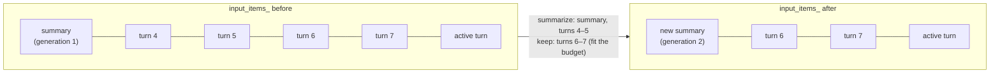

# Context compaction

Every request carries the whole conversation (see
[conversation state](conversation-state.md)), so a long session eventually
gets close to the model's context window. **Compaction** then asks the model
to summarize the older turns and replaces them with that summary. The newest
turns stay word for word. This page explains when compaction runs, how it
picks the turns to summarize, and how it is saved.

The work is split in two. `ContextCompactor` (`context-compaction.cpp`) is
pure policy: given a view of the context it decides what to cut and builds
the new item list, with no I/O. `CodexApi::compactContext()` (`api.cpp`)
does the rest: it requests the summary, saves the checkpoint and installs the
new state.

## Limits

`CompactionConfig` holds four numbers:

| Field | Meaning | Built-in default |
|---|---|---|
| `context_limit_tokens` | The usable context window. | 258,400 |
| `compact_at_tokens` | Compact when the context reaches this size. | 244,800 |
| `retained_context_tokens` | Budget for the recent turns kept word for word. | 20,480 |
| `maximum_summary_bytes` | Longest summary accepted. | 32,768 |

The built-in values are a fallback for a model with a 272,000-token window.
Before an online run, `main.cpp` replaces the first two with values from the
`/models` endpoint (`model-catalog.cpp`):

- `context_limit_tokens` = `context_window` × `effective_context_window_percent`
  (95% when the model does not say);
- `compact_at_tokens` = the model's `auto_compact_token_limit`, but never more
  than 90% of `context_window`.

`MICROCODEX_COMPACT_AT_TOKENS` and `MICROCODEX_RETAINED_CONTEXT_TOKENS`
override the catalog values. Setting `MICROCODEX_COMPACT_AT_TOKENS=0` turns
automatic compaction off.

`main.cpp` keeps the whole catalog in `CodexApiConfig::models`.
`CodexApi::setModel()`, called by `/model`, replaces the first two values with
the new model's and keeps the `MICROCODEX_COMPACT_AT_TOKENS` override. A
context that is larger than the new threshold is compacted by the usual check
before the next request, so switching to a smaller model needs no extra
step.

## When compaction runs

`ContextCompactor::needed()` compares the context size with the threshold,
which is the smaller of `compact_at_tokens` and `context_limit_tokens`. The
size is the larger of two numbers:

- `usage.input_tokens` reported by the last completed request;
- an estimate of the current items, plus the
  [global AGENTS.md](turn-lifecycle.md#the-global-agentsmd) message: their
  total bytes divided by 3, rounded up (`estimateContextTokens()`). Code and JSON use more tokens per byte than
  prose, so this is deliberately cautious, and it needs no tokenizer.

The estimate matters because the reported count is one request old. A large
tool output appended since then is only seen by the estimate.

`compactContext()` checks at four points in a turn:

1. Before the user message is appended, so a full context is reduced before
   the new turn begins.
2. After the user message is appended.
3. After every batch of tool outputs.
4. When a request fails with a context window error. This check is
   **forced**: it skips `needed()`, keeps no recent turns, and happens at most
   once per turn. The request is then retried.

## Choosing the cut

The items of the turn that is running are **protected**: they are never
summarized, because the model is in the middle of using them. Everything
before them is made of completed turns, plus the previous summary if there is
one.

`ContextCompactor::plan()` walks the completed turns from newest to oldest
and keeps adding whole turns while they fit in `retained_context_tokens`.
Everything older is summarized, including an earlier summary. Because the cut
always falls on a turn boundary, a function call is never separated from its
output.



The plan is a `CompactionPlan`. Its key values are `retained_start` (the first
kept item), `through_turn` (the last completed turn) and `keep_from_turn` (the
first kept turn). Planning fails, and nothing is compacted, when:

- there is no completed turn before the active one;
- every completed turn fits the budget, so nothing older than the kept turns
  is left to summarize (an existing summary is not summarized on its own);
- the boundaries do not match the items, which would be a bug.

An automatic check treats a failed plan as "nothing to do" and lets the
request go ahead. A forced check reports it as an error, which fails the turn.

If even the newest completed turn is larger than the budget, no turn is kept
and all completed turns are summarized.

## Requesting the summary

`CodexApi::requestSummary()` sends a separate request to the same endpoint:

- `input` is the items to summarize, followed by the user message
  "Produce the conversation summary now.";
- `instructions` is `ContextCompactor::summaryInstructions()`, which asks for
  the user's goal and constraints, decisions, files touched, commands and
  results, open errors, and remaining work;
- no tools are offered, and no events are emitted, so the UI does not show the
  summary as an answer.

The answer text becomes the summary. An empty summary, or one larger than
`maximum_summary_bytes`, is an error.

## Installing the result

`ContextCompactor::prepare()` builds the new state from the plan and the
summary: one summary item, followed by every item from `retained_start` on,
with the turn boundaries shifted to match. It also builds the
`CompactionCheckpoint` record.

`compactContext()` then:

1. Appends the checkpoint to the conversation file. If this fails, the
   in-memory state is left untouched and the error is returned.
2. Replaces `input_items_` and `completed_turns_`, and moves the protected
   start index by the same amount.
3. Sets `has_summary_`, increases `compaction_generation_`, resets the
   reported token count and clears the turn state.

Writing the checkpoint first means that a crash at any point leaves a file
that resumes either to the old state or to the new one.

## What stays on disk

Compaction never deletes or rewrites turns. The file keeps every turn record,
and the checkpoint only says where the model's view starts:

```json
{"type":"turn","number":1,"id":"71e514b5-…","items":[…]}
{"type":"checkpoint","generation":1,"through_turn":1,"keep_from_turn":2,"summary":"The seed established compactable state."}
{"type":"turn","number":2,"id":"26fb5212-…","items":[…]}
```

On resume, the last checkpoint supplies the summary item, and only turns from
`keep_from_turn` on are loaded into `input_items_`. `microcodex show` and the
interactive history still read every turn, so the user can see the whole
conversation even though the model only sees the summary. The record format is
in [conversation files](../reference/conversation-files.md#checkpoint).
