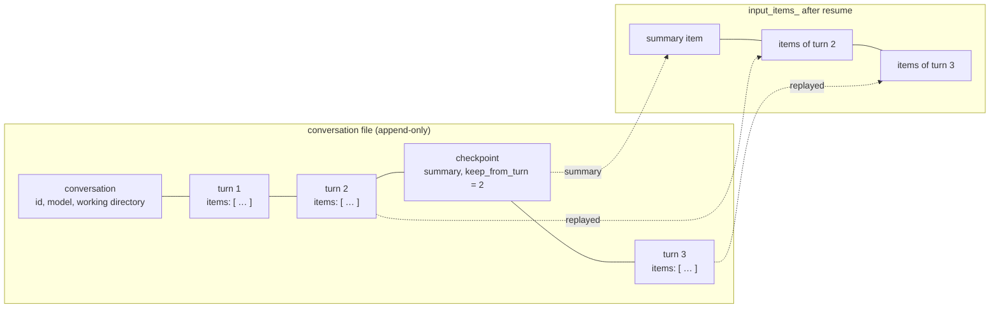

# Conversation state

A conversation exists in two forms: the array `CodexApi` sends to the model,
and the file on disk it can be rebuilt from. This page explains both and how
they map to each other. The [turn lifecycle](turn-lifecycle.md) explains when
the state changes. The exact file format is in
[conversation files](../reference/conversation-files.md).

## Response items

The unit of conversation state is a **response item**: one JSON object in the
Responses API's `input` array. MicroCodex works with three item types:

| Type | Written by | Example |
|---|---|---|
| `message` | the user (`role: "user"`) or the model (`role: "assistant"`) | `{"type":"message","role":"user","content":[{"type":"input_text","text":"Run a slow shell command"}]}` |
| `function_call` | the model | `{"type":"function_call","call_id":"call_slow","name":"bash","arguments":"{\"command\":\"sleep 30\"}"}` |
| `function_call_output` | MicroCodex, after running a tool | `{"type":"function_call_output","call_id":"call_slow","output":"Error: Tool execution timed out after 2 seconds"}` |

The model can also return other item types, such as `reasoning`, which holds
encrypted content. MicroCodex does not interpret those items, but keeps and
replays them like the others.

Every item is stored as a `std::string` holding its JSON text, exactly as it
was received or built. Requests use `"store": false`, so the server keeps no
history between requests. The client must replay every earlier item
unchanged, including the ones it cannot read. Holding the original bytes and
never re-encoding them makes that automatic.

When code needs to look inside an item, `response-item.h` provides typed
views that parse on demand:

```cpp
struct CodexToolCall   { std::string call_id; std::string name; std::string arguments; };
struct CodexToolOutput { std::string call_id; std::string output; };
struct ResponseMessage { std::string role; std::string text; };

std::expected<std::optional<ResponseMessage>, std::string> responseMessage(std::string_view item);
std::expected<std::optional<CodexToolCall>, std::string>   responseToolCall(std::string_view item);
```

Each `response…()` function returns an empty optional when the item has a
different type, and an error only when the item is malformed.
`userMessageItem()`, `assistantMessageItem()` and `toolOutputItem()` build new
items.

## The in-memory model

`CodexApi` keeps the live conversation in two vectors:

```cpp
std::vector<std::string>  input_items_;      // every item sent with the next request
std::vector<TurnBoundary> completed_turns_;  // where each finished turn ends

struct TurnBoundary {
    std::uint64_t number;  // 1, 2, 3, … across the life of the conversation
    std::size_t end;       // index one past the turn's last item in input_items_
};
```

The only item a request sends that is not in `input_items_` is the
[global AGENTS.md](turn-lifecycle.md#the-global-agentsmd) message, which comes
first and is never saved.

`input_items_` is a flat list. The turn boundaries are kept next to it rather
than inside it: a turn is a slice of `input_items_`, and its boundary records
where the slice ends. A turn starts where the previous one ends, or at the
first item.

Here is the state after two turns. The first turn asked for a file and ran
one `write` call; the second was a plain question.

| Index | Item | Turn |
|---|---|---|
| 0 | `message` user "Create the requested file" | 1 |
| 1 | `function_call` `write` | 1 |
| 2 | `function_call_output` "Created result.txt" | 1 |
| 3 | `message` assistant "Created result.txt" | 1 |
| 4 | `message` user "What did you create?" | 2 |
| 5 | `message` assistant "A file named result.txt." | 2 |

`completed_turns_` is `[{number 1, end 4}, {number 2, end 6}]`.

While a turn is running, its items are appended after the last boundary and
have no boundary yet. The turn's start index is kept in a local variable
(`turn_start` in `sendUserMessage()`), which is how a failed turn is rolled
back: `input_items_.resize(turn_start)`.

Boundaries matter because the conversation is only cut at them. Compaction
summarizes whole turns and keeps whole turns. Splitting a turn could separate
a `function_call` from its `function_call_output`, and the API rejects such a
request.

### After compaction

Compaction replaces the oldest turns with a single summary item at index 0.
The summary is a user message wrapping the model's summary in
`<conversation_summary>` tags. If turn 1 above were summarized and turn 2 kept,
the state would be:

| Index | Item | Turn |
|---|---|---|
| 0 | `message` user `<conversation_summary>…</conversation_summary>` | summary |
| 1 | `message` user "What did you create?" | 2 |
| 2 | `message` assistant "A file named result.txt." | 2 |

`completed_turns_` becomes `[{number 2, end 3}]`. Turn numbers do not change;
only the `end` indexes shift. `has_summary_` is now `true`, so the first turn
starts at index 1 instead of 0. See [context compaction](context-compaction.md)
for how the cut is chosen.

### Other per-conversation fields

| Field | Meaning |
|---|---|
| `session_id_` | The conversation ID. It names the file and is sent as `prompt_cache_key`, so a resumed conversation keeps using the same prompt cache. |
| `turn_number_` | The number of the last turn started. |
| `has_summary_`, `compaction_generation_` | Whether index 0 is a summary, and how many compactions have happened. |
| `reported_input_tokens_` | `usage.input_tokens` from the last completed request, used to decide when to compact. |
| `turn_state_` | The `x-codex-turn-state` header value, sent back within one turn. |
| `conversation_file_` | The open `ConversationFile`, or empty when persistence is off. |

## The file on disk

`ConversationFile` (`conversation.h`) is the only durable copy of a
conversation. It is a JSONL file at `$CODEX_HOME/conversations/<id>.jsonl`:
one JSON record per line, appended and never rewritten.



There are three record types:

- **`conversation`**: the first line, holding the metadata (ID, creation
  time, working directory, model).
- **`turn`**: one per terminal turn, completed or interrupted, holding that
  turn's items verbatim. A failed turn is never written.
- **`checkpoint`**: written by each compaction, holding the summary and the
  number of the first turn it did not summarize (`keep_from_turn`).

A turn record is written once, when its turn ends. The record holds exactly
the slice `input_items_[turn_start, end)` of that turn, so the file and the
memory always agree on the items of every saved turn. Each append is followed
by `fsync()`.

### Rebuilding the state on resume

`ConversationFile::resume()` reads the file once from the start, checks every
record, and returns a `ResumedConversation`:

1. Remember where each turn record starts (`TurnLocation`: number, offset,
   length) and keep the last checkpoint.
2. If there is a checkpoint, start `input_items_` with its summary item.
3. Append the items of every turn whose number is at least the checkpoint's
   `keep_from_turn` (all turns when there is no checkpoint), and add a
   `TurnBoundary` after each one.

The result is the same `input_items_` and `completed_turns_` the previous
process had after its last saved turn. Turns before `keep_from_turn` stay in
the file, but are not loaded into memory.

### Reading history without loading it

The turn locations make history reading cheap. `readTurnsBefore(cursor,
maximum_bytes)` seeks straight to the newest turns before index `cursor` and
reads backwards until the byte budget is used up. It returns at least one
turn, even when that turn alone is larger than the budget. The interactive UI uses it to show the most recent 512 KiB of a
resumed conversation, including turns that compaction removed from the model
context. `microcodex show ID` uses it with no limit to print the whole
conversation.
