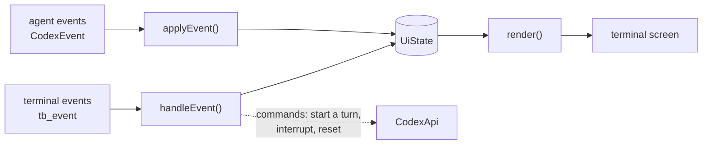
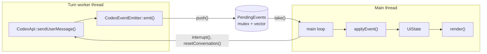

# Terminal UI

`microcodex` with no prompt starts an interactive session, implemented in
`ui.cpp` by `runInteractive()`. This page explains the state-and-events model
the UI is built on, how the UI talks to the agent, how its main loop works,
and how a transcript becomes terminal rows. The keys are listed in the
[command line reference](../reference/cli.md#interactive-keys).

## State, events and a reducer

The UI follows one simple model: **the screen is a function of a single state
value, and that state only changes in response to events.** This is the
pattern known as a state reducer (or event/reducer architecture).

- **State**: one struct, `UiState`, holds everything the screen shows: the
  transcript, the composer text and cursor, the status line, the scroll
  offset, and a `dirty` flag that says the screen is out of date.
- **Events**: there are two sources. The agent produces `CodexEvent`s (text
  arrived, a tool started, the turn ended). The terminal produces `tb_event`s
  (a key, a mouse wheel step, a resize).
- **Reducers**: each kind of event has one function that takes the state and
  a single event, and updates the state. `applyEvent(UiState&, const CodexEvent&)`
  handles agent events. `handleEvent(UiState&, …, const tb_event&)` handles
  terminal events.
- **View**: `render(UiState&, …)` draws the whole screen from the state. It
  never looks at events.

Streaming text shows how little each piece has to know. When a `TextDelta`
arrives, `applyEvent()` appends its text to the last assistant entry (or
creates one) and sets `dirty`. That is all it does. On the next pass of the
main loop, `render()` sees `dirty` and redraws the transcript, now with the
new text. Neither function knows about the other.

This gives a short checklist for changing the UI:

1. Add a field to `UiState` for whatever the screen needs to remember.
2. Change it in the reducer for the event that should affect it, and set
   `dirty`.
3. Read it in `render()` or one of the functions it calls.

Never draw from an event handler, and never touch `UiState` from another
thread. Agent events reach the main thread through a queue, described below,
so the reducers always run on the main thread.

The implementation is pragmatic rather than strict, in three ways:

- **The state is changed in place.** A reducer receives `UiState&` and
  modifies it. It does not return a new copy, which would mean copying up to
  512 KiB of transcript per keystroke.
- **Terminal reducers can issue commands.** Enter starts a turn
  (`startTurn()` launches the worker thread), Esc and Ctrl-C call
  `CodexApi::interrupt()`, Ctrl-R calls `resetConversation()`, and Ctrl-L asks
  termbox to repaint everything. `applyEvent()` has no such side effects: agent
  events only ever change `UiState`.
- **`render()` writes back derived values.** It clamps `scroll` to the
  transcript length, fills each assistant entry's Markdown cache, records
  which row holds the "Working" animation, and clears `dirty`. These are
  caches and layout results, not new information, so the state still decides
  what is shown.

## Two threads and a queue

The UI runs on the main thread and owns the terminal and all display state
(`UiState`). Each turn runs on a worker thread started with `std::async`,
because `CodexApi::sendUserMessage()` blocks until the turn ends. The two
threads share exactly one object, a mutex-protected event queue:

`PendingEvents::push()` runs on the worker thread, inside the network
callback that produced the event. It copies the event and does two things to
keep the main thread's work small:

- It merges consecutive `TextDelta` events of the same turn into one, because
  a model stream sends many tiny deltas.
- It cuts the text of tool events to 16 KiB, and drops the text of
  `TurnCompleted`, which repeats the streamed answer.

`push()` must not throw into the agent. If copying fails (out of memory), it
sets a flag instead, and the UI shows "A display update was dropped".

Commands travel the other way through direct `CodexApi` calls. `interrupt()`
is designed to be called from another thread. `resetConversation()` and
`readHistoryBefore()` are only called when no turn is running.

## The main loop

Each pass of the loop in `runInteractive()`:

1. Takes all queued events and applies them to `UiState` (`applyPendingEvents()`).
2. Checks whether the turn's `std::future` is ready. If it is, it drains the
   queue once more and shows the returned error, if any (`collectFinishedTurn()`).
3. Redraws the whole screen if `UiState::dirty` is set.
4. Waits for terminal input: up to 32 ms while a turn runs, 250 ms otherwise.
   If input arrives, it handles the key, mouse or resize event. If the wait
   times out during a turn, it only redraws the animated "Working" row
   (`renderWorkingFrame()`).

The short wait during a turn keeps the animation moving and lets streamed text
appear quickly. Redrawing only the status row between events avoids
re-wrapping the transcript about 31 times a second.

On exit (Ctrl-Q, or Ctrl-D on an empty composer) the loop interrupts any
active turn, waits for it, and calls `shutdown()`. `TerminalGuard` restores
the terminal on every return path.

## Display state

`UiState` holds the transcript as a `std::deque<UiEntry>`. An entry is one
block on screen:

| `EntryKind` | Created by | Shows |
|---|---|---|
| `User` | sending a message | The message on a shaded background. |
| `Assistant` | `TextDelta` | Streamed text, rendered as Markdown. |
| `Tool` | `ToolStarted`, completed by `ToolFinished` (matched by `call_id`) | The call, then its output or diff. |
| `Error`, `Notice` | `Error`, `TurnInterrupted`, local failures | One message line. |

The transcript is limited to 512 KiB of text. When it grows past that, the
oldest entries are dropped from the display. This affects only the screen:
the conversation and its file are unchanged.

Resuming a conversation fills the transcript from the file before the first
frame (`loadSavedHistory()`): it reads the newest 512 KiB of saved turns with
`CodexApi::readHistoryBefore()` and turns their items back into entries.

## From entries to rows

Rendering works in **styled lines**. A `StyledLine` (`styled-text.h`) is one
terminal row: a list of `StyledSpan` (text plus a termbox color and
attribute), an optional background, and whether that background fills the
row. Every renderer produces styled lines, already wrapped to the terminal
width:

| Content | Renderer |
|---|---|
| Assistant text | `renderMarkdown()` (`markdown.cpp`), which walks md4c's parser callbacks. |
| `bash` commands | `highlightShell()` (`shell-highlight.cpp`), a lexer that colors command names, keywords, options, strings, variables, operators and comments. |
| `edit` results | `appendEditLines()` in `ui.cpp`, which draws the hunks of the `EditResult` with line numbers and colored backgrounds. |
| Everything else | `wrapStyledText()`. |

`transcriptLines()` concatenates the lines of every entry. `render()` then
draws the bottom of that list, minus the scroll offset, above the composer
and the footer.

Two things keep this affordable on every frame:

- Each assistant entry caches its rendered Markdown (`MarkdownRenderCache`).
  The text only ever grows, so the cache is valid while the text length and
  the width are unchanged.
- Tool output is shown collapsed to 5 rows: the first and last two, with a
  "… +N lines (ctrl + t to view full output)" row in between. Ctrl-T shows
  every row.

Colors are 256-color palette indexes (for example 236 for the shaded
surfaces), not true color. termbox2 then stores each cell's attributes in 16
bits instead of 32.

## Input

The composer holds the message being typed as a UTF-8 string (`UiState::input`)
and a byte offset for the cursor. Cursor movement steps over whole code
points, and the composer wraps to at most 6 rows.

termbox2 has no paste event, so `termbox.cpp` adds one. It registers an input
hook (`TB_FUNC_EXTRACT_PRE`) that recognizes the bracketed-paste markers
`ESC [200~` and `ESC [201~` and reports them as two custom event types. Keys
between the markers are collected as pasted text instead of being treated as
commands. The same hook turns the `ESC b`, `ESC f` and `ESC Backspace` pairs
that many terminals send for Option and Alt keys into single key events with
the Alt modifier.

A paste of more than 1,000 characters, or one with control or invisible
format characters, is not shown as typed text. The composer shows a label,
such as `[Pasted Content 1200 chars]`, and the real text is kept in
`UiState::pending_pastes`. The label is edited as one unit: erasing any part
of it removes the whole paste. When the message is sent, each label is
replaced with its text.
