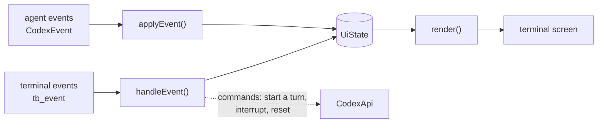
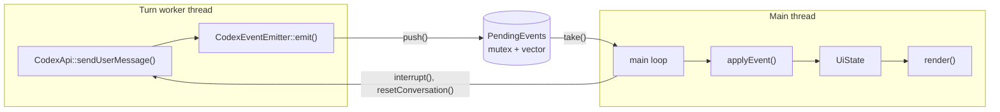
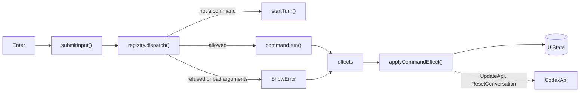

# Terminal UI

`microcodex` with no prompt starts an interactive session, implemented in
`ui.cpp` by `runInteractive()`. This page explains the state-and-events model
the UI is built on, how the UI talks to the agent, how its main loop works,
how a transcript becomes terminal rows, and how slash commands run. The keys
and commands are listed in the
[command line reference](../reference/cli.md#interactive-keys).

## State, events and a reducer

The UI follows one simple model: **the screen is a function of a single state
value, and that state only changes in response to events.** This is the
pattern known as a state reducer (or event/reducer architecture).

- **State**: one struct, `UiState`, holds everything the screen shows: the
  transcript, the composer text and cursor, the status line, the scroll
  offset, and a `dirty` flag that says the screen is out of date.
- **Events**: there are two sources. The agent produces `CodexEvent`s (text
  arrived, a tool started, the turn ended). The terminal produces `tb_event`s
  (a key, a mouse wheel step, a resize).
- **Reducers**: each kind of event has one function that takes the state and
  a single event, and updates the state. `applyEvent(UiState&, const CodexEvent&)`
  handles agent events. `handleEvent(UiState&, …, const tb_event&)` handles
  terminal events.
- **View**: `render(UiState&, …)` draws the whole screen from the state. It
  never looks at events.



Streaming text shows how little each piece has to know. When a `TextDelta`
arrives, `applyEvent()` appends its text to the last assistant entry (or
creates one) and sets `dirty`. That is all it does. On the next pass of the
main loop, `render()` sees `dirty` and redraws the transcript, now with the
new text. Neither function knows about the other.

This gives a short checklist for changing the UI:

1. Add a field to `UiState` for whatever the screen needs to remember.
2. Change it in the reducer for the event that should affect it, and set
   `dirty`.
3. Read it in `render()` or one of the functions it calls.

Never draw from an event handler, and never touch `UiState` from another
thread. Agent events reach the main thread through a queue, described below,
so the reducers always run on the main thread.

The implementation is pragmatic rather than strict, in three ways:

- **The state is changed in place.** A reducer receives `UiState&` and
  modifies it. It does not return a new copy, which would mean copying up to
  512 KiB of transcript per keystroke.
- **Terminal reducers can issue commands.** Enter starts a turn
  (`startTurn()` launches the worker thread), Esc and Ctrl-C call
  `CodexApi::interrupt()`, Ctrl-R calls `resetConversation()`, and Ctrl-L asks
  termbox to repaint everything. `applyEvent()` has no such side effects: agent
  events only ever change `UiState`.
- **`render()` writes back derived values.** It clamps `scroll` to the
  transcript length, fills each assistant entry's Markdown cache, records
  which row holds the "Working" animation, and clears `dirty`. These are
  caches and layout results, not new information, so the state still decides
  what is shown.

## Two threads and a queue

The UI runs on the main thread and owns the terminal and all display state
(`UiState`). Each turn runs on a worker thread started with `std::async`,
because `CodexApi::sendUserMessage()` blocks until the turn ends. The two
threads share exactly one object, a mutex-protected event queue:



`PendingEvents::push()` runs on the worker thread, inside the network
callback that produced the event. It copies the event and does two things to
keep the main thread's work small:

- It merges consecutive `TextDelta` events of the same turn into one, because
  a model stream sends many tiny deltas.
- It cuts the text of tool events to 16 KiB, and drops the text of
  `TurnCompleted`, which repeats the streamed answer.

`push()` must not throw into the agent. If copying fails (out of memory), it
sets a flag instead, and the UI shows "A display update was dropped".

Commands travel the other way through direct `CodexApi` calls. `interrupt()`
is designed to be called from another thread. `resetConversation()` and
`readHistoryBefore()` are only called when no turn is running.

## The main loop

Each pass of the loop in `runInteractive()`:

1. Takes all queued events and applies them to `UiState` (`applyPendingEvents()`).
2. Checks whether the turn's `std::future` is ready. If it is, it drains the
   queue once more and shows the returned error, if any (`collectFinishedTurn()`).
3. Redraws the whole screen if `UiState::dirty` is set.
4. Waits for terminal input: up to 32 ms while a turn runs, 250 ms otherwise.
   If input arrives, it handles the key, mouse or resize event. If the wait
   times out during a turn, it only redraws the animated "Working" row
   (`renderWorkingFrame()`).

The short wait during a turn keeps the animation moving and lets streamed text
appear quickly. Redrawing only the status row between events avoids
re-wrapping the transcript about 31 times a second.

On exit (Ctrl-Q, or Ctrl-D on an empty composer) the loop interrupts any
active turn, waits for it, and calls `shutdown()`. `TerminalGuard` restores
the terminal on every return path.

## Display state

`UiState` holds the transcript as a `std::deque<UiEntry>`. An entry is one
block on screen:

| `EntryKind` | Created by | Shows |
|---|---|---|
| `User` | sending a message | The message on a shaded background. |
| `Assistant` | `TextDelta` | Streamed text, rendered as Markdown. |
| `Tool` | `ToolStarted`, completed by `ToolFinished` (matched by `call_id`) | The call, then its output or diff. |
| `Error`, `Notice` | `Error`, `TurnInterrupted`, local failures | One message line. |

The transcript is limited to 512 KiB of text. When it grows past that, the
oldest entries are dropped from the display. This affects only the screen:
the conversation and its file are unchanged.

Resuming a conversation fills the transcript from the file before the first
frame (`loadSavedHistory()`): it reads the newest 512 KiB of saved turns with
`CodexApi::readHistoryBefore()` and turns their items back into entries.

## From entries to rows

Rendering works in **styled lines**. A `StyledLine` (`styled-text.h`) is one
terminal row: a list of `StyledSpan` (text plus a termbox color and
attribute), an optional background, and whether that background fills the
row. Every renderer produces styled lines, already wrapped to the terminal
width:

| Content | Renderer |
|---|---|
| Assistant text | `renderMarkdown()` (`markdown.cpp`), which walks md4c's parser callbacks. |
| `bash` commands | `highlightShell()` (`shell-highlight.cpp`), a lexer that colors command names, keywords, options, strings, variables, operators and comments. |
| `edit` results | `appendEditLines()` in `ui.cpp`, which draws the hunks of the `EditResult` with line numbers and colored backgrounds. |
| Everything else | `wrapStyledText()`. |

`transcriptLines()` concatenates the lines of every entry. `render()` then
draws the bottom of that list, minus the scroll offset, above the composer
and the footer.

Two things keep this affordable on every frame:

- Each assistant entry caches its rendered Markdown (`MarkdownRenderCache`).
  The text only ever grows, so the cache is valid while the text length and
  the width are unchanged.
- Tool output is shown collapsed to 5 rows: the first and last two, with a
  "… +N lines (ctrl + t to view full output)" row in between. Ctrl-T shows
  every row.

Colors are 256-color palette indexes (for example 236 for the shaded
surfaces), not true color. termbox2 then stores each cell's attributes in 16
bits instead of 32.

## Input

The composer holds the message being typed as a UTF-8 string (`UiState::input`)
and a byte offset for the cursor. Cursor movement steps over whole code
points, and the composer wraps to at most 6 rows.

termbox2 has no paste event, so `termbox.cpp` adds one. It registers an input
hook (`TB_FUNC_EXTRACT_PRE`) that recognizes the bracketed-paste markers
`ESC [200~` and `ESC [201~` and reports them as two custom event types. Keys
between the markers are collected as pasted text instead of being treated as
commands. The same hook turns the `ESC b`, `ESC f` and `ESC Backspace` pairs
that many terminals send for Option and Alt keys into single key events with
the Alt modifier.

A paste of more than 1,000 characters, or one with control or invisible
format characters, is not shown as typed text. The composer shows a label,
such as `[Pasted Content 1200 chars]`, and the real text is kept in
`UiState::pending_pastes`. The label is edited as one unit: erasing any part
of it removes the whole paste. When the message is sent, each label is
replaced with its text.

## Slash commands

A slash command never changes the UI or the agent itself. It returns a list
of **effects**, plain values that describe what should happen, and the UI
carries them out in one function, `applyCommandEffect()`. This is the agent
event path in reverse: `CodexEvent`s are data the agent hands to the UI's
reducer, and effects are data a command hands to it. Commands are therefore
plain functions of their input, and the code that parses, lists and draws
commands never names a specific one.

The code is split in two:

- `slash-command.cpp` holds the `SlashCommand` interface, the
  `SlashCommandRegistry`, the effect types, and the built-in commands. It does
  not include termbox or `ui.cpp`.
- `ui.cpp` asks the registry for matches and effects, carries the effects
  out, and draws the menu and the picker.

`main.cpp` builds the registry with `makeBuiltinSlashCommands()` and passes it
to `runInteractive()`.

### A command

A command is a `SlashCommand` subclass. The registry rejects a name that is
empty, uses characters other than lowercase letters, digits and `-`, or is
already registered.

| Method | Default | Meaning |
|---|---|---|
| `name()` | required | The text after `/`, such as `effort`. |
| `description()` | required | Shown in the menu. |
| `argumentHint()` | none | Shown after the name, such as `[level]`. A command without a hint takes no arguments. |
| `availableDuringTurn()` | `false` | Whether the command may run while a turn is running. |
| `run(arguments, snapshot)` | required | Returns the effects. `arguments` is the text after the name, trimmed. |

`run()` reads the agent only through its `CommandSnapshot`: whether a turn is
running and, when none is, a `CodexApiStatus` with the model, effort, saved
turn count and context size. During a turn the agent's state belongs to the
worker thread, so the snapshot has no status then. The status is a copy, not
a reference into `CodexApi`.

### Rules for commands

`run()` is meant to be a pure function: the same arguments and snapshot always
give the same effects, and calling it changes nothing. The types enforce part
of this:

- `run()` is `const`, and the registry holds `std::shared_ptr<const SlashCommand>`,
  so a registered command is never modified.
- `run()` receives no `UiState` and no `CodexApi`, only the arguments and the
  snapshot, so it cannot reach either one.

The rest is a convention that review has to check, because `const` does not
prevent `mutable` members, global variables or I/O:

- **A command owns no state.** The built-in commands have no data members.
  State a command needs across calls, such as a toggle, belongs in `UiState`
  or `CodexApi`: the command reads it through the snapshot and changes it by
  returning an effect.
- **Every change is a returned effect.** A command describes what should
  happen and the UI decides whether and when it happens, for example never
  while a turn is running.
- **No I/O in `run()`.** `run()` runs on the main thread, between two frames,
  so a slow file or network call freezes the screen. Work like that needs an
  effect that the UI runs on the worker thread, the way it runs a turn. No
  such effect exists yet.

### Effects

| Effect | What the UI does |
|---|---|
| `ShowNotice{text}`, `ShowError{text}` | Adds a notice or error entry to the transcript. |
| `ResetConversation` | The same as Ctrl-R. |
| `Quit` | The same as Ctrl-Q. |
| `OpenPicker{title, options, selected}` | Opens a picker. Each option holds a full command line, such as `/effort high`. |
| `UpdateApi{apply}` | Calls `apply(CodexApi&)` on the main thread, and shows the text it returns as a notice or an error. Refused while a turn is running. |

A picker option runs its command line exactly as if the user had typed it, so
a picker needs no callbacks and the command validates its argument in one
place. `/effort` with no argument returns an `OpenPicker` whose options are
`/effort none` to `/effort persistent`. Choosing one runs that command, which
returns an `UpdateApi` that calls `CodexApi::setReasoningEffort()`.

`UpdateApi` is the one effect that carries code. The command only builds the
function, and nothing runs until the UI calls it:

```cpp
// In EffortCommand::run(): builds the function and returns it, without calling it.
return {microcodex::UpdateApi{
    [level = std::string(arguments)](microcodex::CodexApi& api) -> std::expected<std::string, std::string> {
        auto changed = api.setReasoningEffort(level);
        if (!changed) return std::unexpected(changed.error());
        return "Reasoning effort set to " + level;
    }}};
```

The function captures `level` by value, so it stays valid after `run()`
returns. `applyCommandEffect()` refuses it while a turn is running, and
otherwise calls `apply(api)` and shows the returned text. So `run()` stays
pure, and the change to the agent happens later, in the UI.

The cost is that a `std::function` cannot be inspected. A test can check that
`run("high", snapshot)` returned an `UpdateApi`, but not what it will do
without calling it on a real `CodexApi`. When that matters, add a dedicated
effect such as `SetReasoningEffort{level}`, which is plain data. That costs
one more variant case and one more branch in `applyCommandEffect()`.
`UpdateApi` remains the general fallback.

### Running a command



`SlashCommandRegistry::dispatch()` reads the name up to the first whitespace.
Text that does not name a registered command goes to `startTurn()` as a
normal message. For a known command, the registry first checks
`availableDuringTurn()` and whether arguments were given to a command that
takes none, and returns an error effect if either check fails. The UI then
clears the composer, applies the effects in order, and reads the model and
effort back from `CodexApi::status()` for the footer.

### The menu and the picker

The menu adds a single field to `UiState`: `command_selection`. The matching
commands are not stored. `render()` and the key handler both call
`SlashCommandRegistry::completions(state.input)`, so they always agree with
the composer. The selection returns to the first entry whenever a key changes
the input.

The open picker is `UiState::picker`. While it is set, it takes every key
except Ctrl-Q, Ctrl-L and scrolling. Both are drawn below the composer and
show at most 10 entries at a time, scrolling to keep the selected one
visible. The footer shows their keys.

### Adding a command

1. Write a `SlashCommand` subclass in `slash-command.cpp` that returns the
   effects it needs.
2. Add it to `makeBuiltinSlashCommands()`. The order there is the order of the
   menu.
3. Add it to the [slash commands table](../reference/cli.md#slash-commands).

If the command needs something no effect can express, add an effect type to
the `CommandEffect` variant and handle it in `applyCommandEffect()`. That is
the only case that changes `ui.cpp`.
