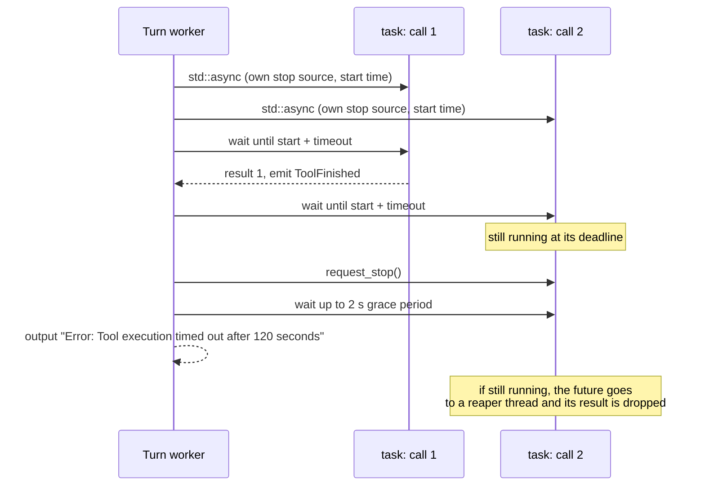

# Tools

A **tool** is a local function the model can call: it sends a
`function_call` item with a name and JSON arguments, MicroCodex runs the
function, and the result goes back as a `function_call_output` item. This
page explains the tool interface in `tool.h` and how `CodexApi` runs calls.
The five built-in tools are described in
[built-in tools](../reference/built-in-tools.md). Adding a new one is walked
through in [adding a tool](../development/adding-a-tool.md).

## The interface

Every tool implements `ToolBase`:

```cpp
class ToolBase {
public:
    virtual std::string_view name() const = 0;
    virtual std::string toJsonString() const = 0;
    virtual std::expected<ToolResult, std::string> executeJson(std::string_view arguments,
                                                               std::stop_token stop_token) const = 0;
};

struct ToolResult {
    std::string output;                      // sent to the model
    std::shared_ptr<const EditResult> edit;  // shown in the UI only, may be null
};
```

- `name()` is the name the model calls. Names must be unique and non-empty;
  `buildRequestBody()` rejects the request otherwise.
- `toJsonString()` returns the definition sent in the request's `tools` array:
  `{"type":"function","name":…,"description":…,"strict":false,"parameters":…}`.
- `executeJson()` receives the call's arguments exactly as the model sent
  them (a JSON object encoded in a string) and the call's stop token.

`ToolResult` keeps what the model sees apart from what the UI shows. The
`edit` tool returns `"Edited <path>"` to the model and puts the diff in
`edit`. The diff is never added to the conversation history, so it costs no
context tokens. `edit` is the only tool that sets this field.

Tools are created once, in `makeCodingTools()`, and shared as
`std::shared_ptr<const ToolBase>`. They are immutable, so several threads can
run the same tool at once.

## The `Tool<>` adapter

Most tools are a plain function plus some JSON handling. The `Tool<T, S...>`
template in `tool.h` wraps a function pointer of type `T (*)(S...)` with
everything else `ToolBase` needs:

```cpp
Tool(std::string name, std::string description, T (*callable)(S...),
     std::string parameters,          // JSON Schema for the arguments
     JsonExecutionAdapter adapter);   // decodes arguments, calls callable, encodes the result
```

The **adapter** connects JSON to C++. It reads the arguments with
`ToolArguments`, checks the stop token, calls the function and turns its
return value into a `ToolResult`. This is the adapter for `glob`, from
`agent.cpp`:

```cpp
std::expected<microcodex::ToolResult, std::string> executeGlob(
    std::expected<std::string, std::string> (*callable)(const std::string&), const ToolArguments& arguments,
    const std::stop_token stop_token) {
    auto pattern = arguments.string("pattern");
    if (!pattern) {
        return std::unexpected(pattern.error());
    }
    if (stop_token.stop_requested()) {
        return std::unexpected("Tool execution interrupted");
    }
    auto result = callable(*pattern);
    if (!result) return std::unexpected(result.error());
    return microcodex::ToolResult{.output = std::move(*result), .edit = {}};
}
```

`ToolArguments` reads top-level members of a flat object: `string(name)`,
`size(name)` for non-negative integers, `boolean(name)`, and
`boolean(name, default)` for an optional flag. A missing or mistyped member
is an error with a message the model can act on, such as
`Missing JSON member 'path'` or
`JSON member 'offset' is not a non-negative integer`.

`Tool::executeJson()` also checks the stop token before and after calling the
adapter, so a tool that was stopped never reports success.

## Running calls

When a reply contains function calls, `CodexApi::executeToolCalls()` runs all
of them at the same time and collects the results in the order the model
made the calls.



Before anything runs, the batch is checked: at most
`maximum_parallel_tool_calls` (32) calls, each with a non-empty, unique
`call_id` and a non-empty name. A batch that fails this check fails the turn.

Each call then gets a `ToolTask`: a `std::future` from `std::async`, its own
`std::stop_source`, and its start time. `ToolStarted` is emitted as each task
starts. A `std::stop_callback` on the turn's stop token forwards an
interruption to every task.

### What a call returns

Each call ends with one output string, and a call never fails the turn. Every
problem becomes an output that starts with `Error: `, so the model can see it
and try something else:

| Situation | Output |
|---|---|
| Success | The tool's output, cut to 64 KiB if longer. |
| Unknown tool name | `Error: Unknown tool 'NAME'` |
| The tool returned an error | `Error: ` followed by the message, such as `Error: Content not found`. |
| The tool threw an exception | `Error: Tool threw an exception: …` |
| The turn was interrupted | `Error: Tool execution interrupted` |
| The call ran too long | `Error: Tool execution timed out after N seconds` |

Output longer than `maximum_tool_output_bytes` (64 KiB) keeps its beginning
and end, with a marker in between:

```text
… first half …
... [tool output truncated from 250000 bytes] ...
… last half …
```

`ToolFinished` carries the output and the `succeeded` flag, which is `false`
for every row of the table except the first.

### Timeouts

`tool_execution_timeout_seconds` (120 by default, `0` disables it) limits each
call. The deadline counts from the call's own start, not from the moment the
collector reaches it. If it counted from the collector, five stuck calls would
take five timeouts in total instead of one.

When a call is past its deadline, every other overdue call in the batch is
stopped at the same moment. They then share one 2-second grace period to
notice the stop and exit. `bash` notices it: it sends `SIGINT` to its process
group, then `SIGKILL` after one second.

A tool that ignores its stop token cannot be waited for. A `std::future` from
`std::async` blocks in its destructor until the task finishes, so the future
is moved to a detached **reaper** thread that waits for it and drops the
result. The turn goes on without it. This is why a task never captures
`CodexApi` (`this`): it may outlive the call that started it. It receives
copies of the tool list, the call and the output limit instead.

## Safety

Tools run with the same permissions as the MicroCodex process, and nothing
is sandboxed. `bash` refuses a short denylist of destructive commands before
starting a shell (`bash-safety.cpp`). The denylist matches the command's text
and is not a security boundary. Beyond that, the only limits are the tools'
own rules, such as `write` refusing to replace an existing file. The patterns
are listed in [built-in tools](../reference/built-in-tools.md#bash).
