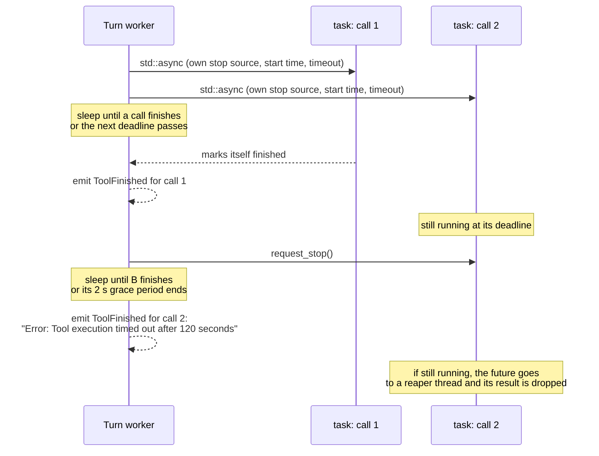

# Tools

A **tool** is a C++ function the model can ask MicroCodex to run. This page
follows one tool, `glob`, from the model's request to the function and back,
then explains how `CodexApi` runs calls. The six built-in tools are described
in [built-in tools](../reference/built-in-tools.md). Writing a new one is
walked through in [adding a tool](../development/adding-a-tool.md).

## What the model sends

The model cannot run code. To use a tool, it puts a `function_call` item in
its reply: the tool's name, and the arguments as a JSON object encoded in a
string.

```json
{"type":"function_call","call_id":"call_1","name":"glob","arguments":"{\"pattern\":\"docs/development/*.md\"}"}
```

MicroCodex runs the tool and answers with a `function_call_output` item that
has the same `call_id` and the result as text:

```json
{"type":"function_call_output","call_id":"call_1","output":"docs/development/adding-a-tool.md\ndocs/development/ci-and-releases.md"}
```

The function that does the work knows nothing about either item. It is
ordinary C++, declared in `glob.h`:

```cpp
std::expected<std::string, std::string> glob(const std::string& pattern);
```

Everything in `tool.h` exists to connect the two sides: to turn a name and a
JSON string into a call of this function, and its return value back into
text.

## A tool is three pieces

`makeCodingTools()` in `agent.cpp` builds the `glob` tool in one statement:

```cpp
tools.emplace_back(std::make_shared<GlobTool>(
    "glob", "Expand a filesystem glob pattern and return matching paths separated by newlines.", glob,
    R"({"type":"object","properties":{"pattern":{"type":"string"}},"required":["pattern"],"additionalProperties":false})",
    executeGlob));
```

The statement puts together three pieces:

| Piece | In the statement | What it does |
|---|---|---|
| **Function** | `glob` | The work. It takes typed parameters and knows nothing about JSON. |
| **Adapter** | `executeGlob` | The translator. It reads `pattern` out of the JSON arguments, calls `glob`, and turns what it returns into the output text. |
| **Definition** | the name, the description and the JSON Schema of the arguments | What the model is told about the tool. It is sent with every request, so the model knows the tool exists and how to call it. |

The adapter is the piece that connects the function to the model. This is
all of it:

```cpp
std::expected<microcodex::ToolResult, std::string> executeGlob(
    std::expected<std::string, std::string> (*callable)(const std::string&), const ToolArguments& arguments,
    const std::stop_token stop_token) {
    auto pattern = arguments.string("pattern");
    if (!pattern) {
        return std::unexpected(pattern.error());
    }
    if (stop_token.stop_requested()) {
        return std::unexpected("Tool execution interrupted");
    }
    auto result = callable(*pattern);
    if (!result) return std::unexpected(result.error());
    return microcodex::ToolResult{.output = std::move(*result), .edit = {}};
}
```

Every built-in adapter takes the same four steps: read the arguments, give up
if the call was stopped, call the function, and wrap its result. Any step can
fail with a message, and the model receives it as `Error: ` followed by the
message, such as `Error: No files matched pattern`.

`GlobTool` is the type that holds the three pieces:

```cpp
using GlobTool = microcodex::Tool<std::expected<std::string, std::string>, const std::string&>;
```

The template arguments of `Tool<>` are the function's return type and
parameter types, copied from its declaration.

## What `CodexApi` sees

`CodexApi` keeps every tool in one list. But each `Tool<>` is a different
C++ type, because each wraps a function with a different signature: the
`Tool<>` for `glob` and the `Tool<>` for `read` cannot go in the same
`std::vector`. So every `Tool<>` derives from one base class, `ToolBase`, and
the list holds `std::shared_ptr<const ToolBase>`.

`ToolBase` describes a tool from the outside: something with a name, a
definition, and a way to run a call given as JSON. `CodexApi` uses these four
members and nothing else:

| `CodexApi` needs to | `ToolBase` member | `Tool<>` answers with |
|---|---|---|
| find the tool a call names | `name()` | the name |
| tell the model about the tool | `toJsonString()` | the definition, as `{"type":"function","name":…,"description":…,"strict":false,"parameters":…}` |
| run a call | `executeJson(arguments, stop_token)` | the adapter, given the function |
| know how long a call may run | `timeout()` | an optional limit, the constructor's last argument (see [timeouts](#timeouts)) |

The function, its parameter types and the adapter stay inside `Tool<>`.
`CodexApi` never sees them, so adding a tool never changes `CodexApi`.

Put together, the `glob` call from the start of this page runs like this:

1. `CodexApi` finds the tool whose `name()` is `glob`.
2. It calls `executeJson()` with the string
   `{"pattern":"docs/development/*.md"}`, on a thread of its own.
3. `Tool<>` passes the function and the arguments to `executeGlob`.
4. `executeGlob` reads `pattern` and calls
   `glob("docs/development/*.md")`.
5. The two paths come back as a `ToolResult`, and `CodexApi` sends its
   `output` to the model as the `function_call_output`.

## Details

### Reading arguments

`ToolArguments` reads the members of the arguments object by name. Each
method returns the value, or a message the model can act on:

| Method | Returns | Member missing | Wrong type |
|---|---|---|---|
| `string(name)` | `std::string`, with JSON escapes decoded | `Missing JSON member 'NAME'` | `Expected a JSON string` |
| `optionalString(name)` | `std::string` | an empty string | `Expected a JSON string` |
| `size(name)` | `std::size_t` | `Missing JSON member 'NAME'` | `JSON member 'NAME' is not a non-negative integer` |
| `boolean(name)` | `bool` | `Missing JSON member 'NAME'` | `JSON member 'NAME' is not a boolean` |
| `boolean(name, default)` | `bool` | `default` | `JSON member 'NAME' is not a boolean` |

These checks matter because the definition sets `"strict":false`: the model
is not forced to follow the JSON Schema, so the adapter is what catches a
missing or mistyped argument. Only strings, integers and booleans can be
read, so a tool's arguments should be a flat object of those.

### What the model sees and what the UI shows

`executeJson()` returns a `ToolResult`:

```cpp
struct ToolResult {
    std::string output;                      // sent to the model
    std::shared_ptr<const EditResult> edit;  // shown in the UI only, may be null
};
```

The `edit` tool returns `"Edited <path>"` to the model and puts the diff in
`edit`. The diff is never added to the conversation history, so it costs no
context tokens. `edit` is the only tool that sets this field.

### Checks `Tool<>` adds

`Tool::executeJson()` checks the stop token before it calls the adapter and
again after, so a call that was stopped never reports success. It also
refuses to run without an adapter, with
`Tool 'NAME' has no JSON execution adapter`. The adapter is an optional
constructor argument, so a tool built without one is still offered to the
model, but every call of it fails.

### Limits of the function

The function is stored as a plain function pointer, `T (*)(S...)`. Two things
follow from that:

- **An overloaded function needs a cast** to pick one overload. `bash` has
  two, so `makeCodingTools()` casts it to the one that takes a stop token.
- **It cannot carry state.** A pointer to a function captures nothing, so a
  tool that needs data beyond its arguments has to reach it some other way;
  see [tools that need session state](../development/adding-a-tool.md#tools-that-need-session-state).

Tools are created once, in `makeCodingTools()`, and never change, so several
threads can run the same tool at once.

## Running calls

When a reply contains function calls, `CodexApi::executeToolCalls()` runs all
of them at the same time. It emits `ToolFinished` for each call as soon as
that call ends, so a slow call does not hold back the calls that finished
after it. The results it returns, and the outputs the model receives, keep
the order the model made the calls.



Before anything runs, the batch is checked: at most
`maximum_parallel_tool_calls` (32) calls, each with a non-empty, unique
`call_id` and a non-empty name. A batch that fails this check fails the turn.

Each call then gets a `ToolTask`: a `std::future` from `std::async`, its own
`std::stop_source`, its start time and its timeout. `ToolStarted` is emitted
as each task starts. A `std::stop_callback` on the turn's stop token forwards
an interruption to every task.

Each task marks itself finished in a `ToolBatchProgress`, shared with the
collecting thread, just before it returns. The collector sleeps on that
object's condition variable until a call finishes or the next deadline
passes, then reports every call that has finished. `std::future` has no way
to wait for whichever of several futures is ready first, which is why the
tasks signal it themselves. The object is shared through a `std::shared_ptr`
because a task that times out may outlive the batch.

### What a call returns

Each call ends with one output string, and a call never fails the turn. Every
problem becomes an output that starts with `Error: `, so the model can see it
and try something else:

| Situation | Output |
|---|---|
| Success | The tool's output, cut to 64 KiB if longer. |
| Unknown tool name | `Error: Unknown tool 'NAME'` |
| The tool returned an error | `Error: ` followed by the message, such as `Error: Content not found`. |
| The tool threw an exception | `Error: Tool threw an exception: …` |
| The turn was interrupted | `Error: Tool execution interrupted` |
| The call ran too long | `Error: Tool execution timed out after N seconds` |

Output longer than `maximum_tool_output_bytes` (64 KiB) keeps its beginning
and end, with a marker in between:

```text
… first half …
... [tool output truncated from 250000 bytes] ...
… last half …
```

`ToolFinished` carries the output and the `succeeded` flag, which is `false`
for every row of the table except the first.

### Timeouts

Each call has a time limit. A tool whose `timeout()` returns a value uses that
value, and `0` means no limit, so only an interruption stops the call. Every
other tool, and an unknown tool name, uses `tool_execution_timeout_seconds`
(120 by default, `0` disables it). A tool's own value always wins over the
session's, so a long-running tool keeps its limit whatever
`MICROCODEX_TOOL_EXECUTION_TIMEOUT_SECONDS` is set to. Of the built-in tools,
only `agent` sets its own limit: `0`, because a sub-agent runs a whole turn
with its own tool limits.

The deadline counts from the call's own start, not from the moment the
collector notices it. If it counted from the collector, five stuck calls would
take five timeouts in total instead of one.

When a call is past its deadline, every other overdue call in the batch is
stopped at the same moment. They then share one 2-second grace period to
notice the stop and exit. `bash` notices it: it sends `SIGINT` to its process
group, then `SIGKILL` after one second.

A tool that ignores its stop token cannot be waited for. A `std::future` from
`std::async` blocks in its destructor until the task finishes, so the future
is moved to a detached **reaper** thread that waits for it and drops the
result. The turn goes on without it. This is why a task never captures
`CodexApi` (`this`): it may outlive the call that started it. It receives
copies of the tool list, the call and the output limit instead.

## Safety

Tools run with the same permissions as the MicroCodex process, and nothing
is sandboxed. `bash` refuses a short denylist of destructive commands before
starting a shell (`bash-safety.cpp`). The denylist matches the command's text
and is not a security boundary. Beyond that, the only limits are the tools'
own rules, such as `write` refusing to replace an existing file. The patterns
are listed in [built-in tools](../reference/built-in-tools.md#bash).
