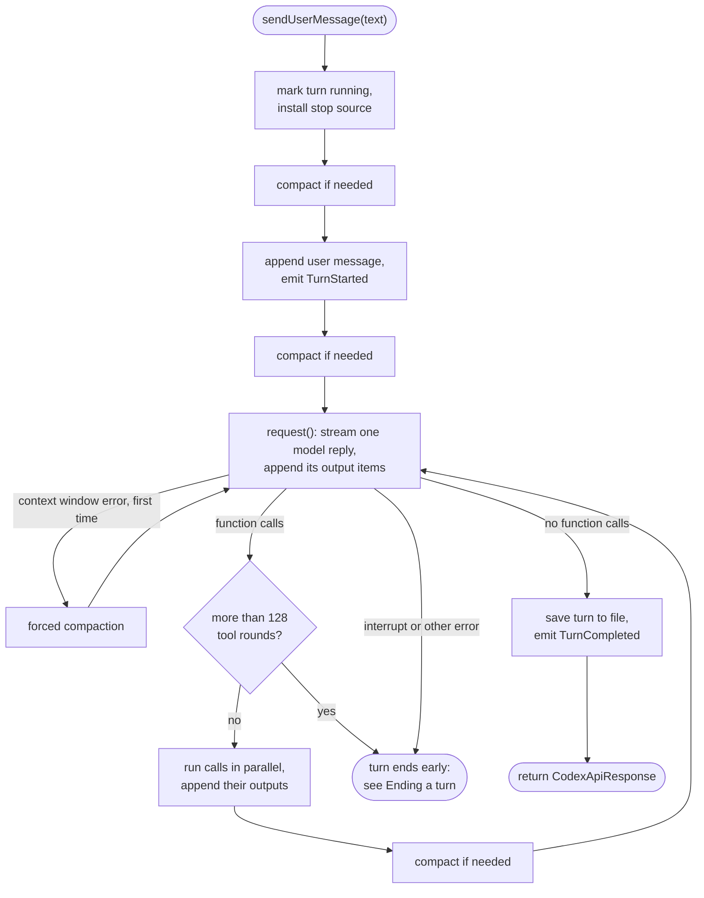

# Turn lifecycle

A **turn** starts with one user message and ends when the model answers
without calling a tool, or when something stops it. This page follows
`CodexApi::sendUserMessage()` in `api.cpp` through a turn. The data the turn
reads and writes is described in [conversation state](conversation-state.md).
How tools run is in [tools](tools.md).

## Rounds inside a turn

One turn usually takes several requests to the model. Each request is a
**sampling round**. When the model's reply contains function calls,
MicroCodex runs them, adds their outputs to the conversation, and sends the
whole conversation again so the model can see the results. The turn ends with
the first reply that has no function calls.



The checks marked "compact if needed" call `CodexApi::compactContext()`. It
returns at once unless the context is close to the model's limit; see
[context compaction](context-compaction.md).

## Starting a turn

`sendUserMessage()` rejects an empty message, then calls
`initializeConversation()`, which opens or creates the conversation file the
first time. Under `turn_mutex_` it then:

- refuses to start if `shutdown()` was called or another turn is running;
- sets `turn_running_` and stores a fresh `std::stop_source` in
  `active_turn_stop_`, which `interrupt()` uses.

A `RunningTurnGuard` clears both on every return path. Before changing any
state, the turn also records `turn_start` (the size of `input_items_`), the
previous turn number and the previous turn state. These are what a failed
turn rolls back to.

## One sampling round

`CodexApi::request()` builds the request body from `input_items_` and calls
`performRequest()`, which posts it with `performHttpRequest()` and parses the
response as it arrives.

### The request

The body is built by `CodexApi::buildRequestBody()`:

| Field | Value |
|---|---|
| `model` | `CodexApiConfig::model`, for example `gpt-6-sol`. |
| `instructions` | The system prompt plus the skills catalog. |
| `input` | The [global AGENTS.md](#the-global-agentsmd) message when there is one, then every item in `input_items_`, in order. |
| `tools`, `tool_choice`, `parallel_tool_calls` | The tool definitions, `"auto"` and `true`. |
| `reasoning` | `{"effort": …}`. The value `persistent` is sent as `disabled`, and `ultra` as `max`. |
| `store` | `false`: the server keeps nothing, so every request carries the full conversation. |
| `stream` | `true`. |
| `include` | `["reasoning.encrypted_content"]`, so reasoning items can be replayed. |
| `prompt_cache_key` | The session ID, which is the conversation ID. |
| `client_metadata` | Installation, session, thread and window IDs. The window ID is `<session>:<compaction generation>`. |

### The global AGENTS.md

At startup `makeCodingAgentConfig()` calls `loadGlobalInstructions()`
(`skills.cpp`), which reads `$CODEX_HOME/AGENTS.override.md`, or
`$CODEX_HOME/AGENTS.md` when the override is missing, unreadable or blank.
A file that cannot be read is skipped without a message. The text is trimmed and stored in
`CodexApiConfig::user_instructions`. Every sampling request then starts its
`input` with it as a user message:

```text
# AGENTS.md instructions

<INSTRUCTIONS>
Answer tersely.
</INSTRUCTIONS>
```

The message is built once, when `CodexApi` is created, and is never added to
`input_items_`. As a result:

- it is not saved in the conversation file, so `resume` and `show` never see
  an old copy, and a resumed conversation uses the file as it is now;
- compaction never summarizes or drops it;
- summary requests do not include it.

The context size that compaction compares against its threshold includes the
message.

Only the first 32 KiB of the file is used, cut at a character boundary.
Nothing is printed when a file is cut. Instead, a note is appended inside the
block, so the model knows that the rest exists and where to read it:

```text
…the last kept line
<truncated>Only the first 32768 of 40000 bytes of /home/user/.codex/AGENTS.md were loaded.</truncated>
</INSTRUCTIONS>
```

### The response

The response is a server-sent event stream. The idle timeout
(`idle_timeout_seconds`, 300) ends a stream whose average speed stays below
one byte per second for that many seconds. There is no total time limit.

### Streaming the reply

`consumeSse()` splits the body into lines and collects `data:` fields until a
blank line ends the event. `handleEvent()` then acts on the event type:

| Event | Effect |
|---|---|
| `response.output_text.delta` | Appends the delta to the answer text and emits `TextDelta`. |
| `response.output_item.done` | Stores the item's JSON exactly as received. A `function_call` item is also parsed into a `CodexToolCall`. |
| `response.completed` | Reads `usage.input_tokens` and marks the stream complete. If no deltas arrived, the text of the final message items is emitted as one `TextDelta`. |
| `response.failed`, `response.incomplete`, `error` | Ends the round with the error message from the event. |
| anything else | Ignored. |

The response header `x-codex-turn-state` is stored and sent back on the
following requests of the same turn. A stream that closes before
`response.completed` is an error.

When the round succeeds, every stored output item is appended to
`input_items_`. If the round has function calls, they run next, and their
`function_call_output` items are appended as one batch, in the order the model
made the calls. Each call is always followed by an output, even an error
output, so the conversation stays valid input for the next request.

## Ending a turn

A turn ends in one of three ways. Which one depends on whether the work done
so far is still useful to the model.

| Outcome | Caused by | `input_items_` | File | Event |
|---|---|---|---|---|
| **Completed** | A reply with no function calls. | Keeps the turn. | Turn appended. | `TurnCompleted` |
| **Interrupted** | `interrupt()`; `response.incomplete` with reason `max_output_tokens`; more than 128 tool rounds; a transport failure; an HTTP 5xx response. | Keeps every complete item and any partial text, plus a `<turn_aborted>` marker. | Turn appended. | `TurnInterrupted` |
| **Failed** | Anything else: an HTTP 4xx response, `response.failed`, an `error` event, more than 32 calls in one reply, a compaction or save failure. | Truncated back to `turn_start`. | No turn record. A compaction checkpoint written earlier in the turn stays. | `Error` |

In the interrupted and failed cases `sendUserMessage()` still returns the
error, so a one-shot run exits with status 1.

An interruption only counts as **interrupted** once the turn's requests have
started. If it arrives while one of the two compaction checks at the start of
the turn is requesting a summary, the summary request fails and the turn ends
as **failed**, with the user message rolled back.

An interrupted turn is saved because its partial work matters. The user can
send `continue`, and the model sees exactly what it produced before the stop.
The marker is an ordinary user message. This turn, copied from the test suite,
was cut off by the output token limit:

```json
{"type":"turn","number":1,"id":"d2295760-…","items":[
  {"type":"message","role":"user","content":[{"type":"input_text","text":"Start incomplete response test"}]},
  {"type":"message","role":"assistant","content":[{"type":"output_text","text":"Partial limited answer"}]},
  {"type":"message","role":"user","content":[{"type":"input_text","text":"<turn_aborted>\nThe Codex response was incomplete: max_output_tokens\n</turn_aborted>"}]}]}
```

If the stream stopped after text deltas but before the final message item,
`request()` adds an assistant message built from the streamed text, so the
partial answer is not lost. When the tool round limit is hit, the calls of the
last reply are paired with outputs that say they were not executed.

A failed turn is rolled back because there is nothing safe to keep. The
conversation goes back to how it was after the previous turn, even when
earlier tool rounds of the failed turn succeeded. The tools' changes to files
on disk are not undone.

## Events

A front end sees a turn as a sequence of `CodexEvent` values (`event-emitter.h`).
A successful turn with one tool call emits:

```text
TurnStarted
TextDelta …            (zero or more)
ToolStarted            (one per call; text = the arguments JSON)
ToolFinished           (one per call, in call order; text = the output)
TextDelta …
TurnCompleted          (text = the full answer)
```

Once a turn has started, its last event is always one of `TurnCompleted`,
`TurnInterrupted` or `Error`, and it is emitted before `sendUserMessage()`
returns. An `Error` can also come before `TurnStarted` when the first
compaction check fails. Calls rejected before the turn starts (an empty
message, a failed `initializeConversation()`, a turn already running, or a
call after `shutdown()`) return an error and emit no event.

In one-shot mode, `runPrompt()` in `main.cpp` writes `TextDelta` to stdout and
the tool events to stderr. Test T3.1 runs a turn with one `write` call, and a
terminal shows it like this:

```text
$ microcodex Create the requested file

[tool write] {"path":"result.txt","content":"made by tool\n"}
[tool write completed] Created result.txt
Created result.txt
```

The two `[tool …]` lines, and the blank line before them, are stderr. The
last line is the model's answer on stdout, so `microcodex … > answer.txt`
captures only the answer.

## Controlling a running turn

These `CodexApi` methods are safe to call from another thread while a turn
runs:

| Method | Effect |
|---|---|
| `interrupt()` | Requests a stop. The turn ends as **interrupted** once the HTTP transfer or the running tools notice it. |
| `shutdown()` | Like `interrupt()`, and rejects every later turn. The caller still joins its own worker thread. |
| `turnInProgress()` | Reports whether a turn is running. |

`resetConversation()` and `readHistoryBefore()` return an error while a turn
runs. A reset clears the in-memory conversation and picks a new session ID.
The next turn then creates a new conversation file, and the old file stays on
disk.
