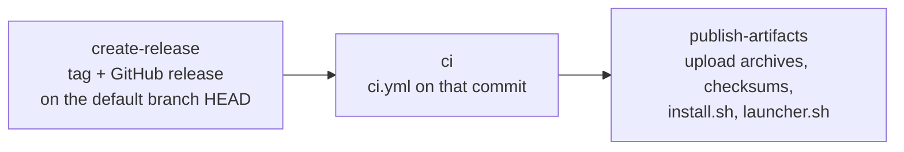

# CI and releases

This page describes what CI checks, how a release is published, and how the
installer and launcher use the release assets. The workflows are in
`.github/workflows/`. The local versions of the checks are listed in
[CONTRIBUTING.md](../../CONTRIBUTING.md#making-changes).

## CI

`ci.yml` runs on every push and pull request, and can be started by hand. The
release workflow also calls it for the commit being released. A new push
cancels the older run for the same branch or pull request, except when the
release workflow started the run.

All jobs run independently:

| Job | Runner | Checks |
|---|---|---|
| Format | Ubuntu 24.04 | `make format-check` with clang-format 18. |
| Lint (clang-tidy, -Werror) | Ubuntu 24.04 | `make lint` with clang-tidy 19. Every finding is an error. |
| Lint scripts | Ubuntu 24.04 | `shellcheck` on `install.sh`, `launcher.sh` and `tests/*.sh`. `ruby -wc` on every Ruby test file, failing on any warning. |
| Verify x86_64-unknown-linux-gnu | Debian 12 container on x86_64 | Installer syntax, build with `WERROR=1`, `make test`, the glibc baseline, and the release archive. |
| Verify aarch64-unknown-linux-gnu | Debian 12 container on arm64 | The same, on arm64. |
| Verify aarch64-apple-darwin | macOS 26, Apple Silicon | Installer syntax, build with `WERROR=1`, `make test`, and the release archive. |
| Verify x86_64-apple-darwin | macOS 26, Intel | The same, on Intel. |

clang-format is pinned to version 18 because different versions format the
same code differently. clang-tidy needs version 19 or newer, because older
versions cannot parse libstdc++'s `<expected>`.

### Linux binary compatibility

The Linux binaries are built on Debian 12 so that they run on older
distributions. A binary needs at least the glibc version it was linked
against, so building on a recent distribution would raise that minimum. The
build job checks this in two ways:

- the container must report glibc 2.36;
- `readelf` must find no symbol version newer than `GLIBC_2.36` or
  `GLIBCXX_3.4.30` in `build/microcodex`.

A change that pulls in a newer symbol fails this step, even if it builds and
passes the tests.

### Build artifacts

Each verify job packages its binary and uploads it as the artifact
`release-<target>`, kept for 7 days:

| File | Contents |
|---|---|
| `microcodex-<target>.tar.gz` | An archive with a single entry, the binary `microcodex-<target>`. |
| `microcodex-<target>.tar.gz.sha256` | The archive's SHA-256. |
| `microcodex-<target>.sha256` | The binary's SHA-256. The launcher uses it to detect updates. |

## Cutting a release

Releases are made with the **Release** workflow (`release.yml`), started by
hand from the default branch with a tag such as `v0.2.0` or `v0.2.0-beta.1`
and an optional title. It runs three jobs in order:

1. **create-release** checks that the workflow runs on the default branch,
   that the tag is well formed, and that neither the tag nor a release with
   that name exists. It then creates the tag and the GitHub release at the
   branch's current commit, with generated release notes, marked as latest.
2. **ci** runs the full CI workflow on that commit.
3. **publish-artifacts** runs only if every CI job passed. It downloads the
   four build artifacts, adds `install.sh` and `launcher.sh` with their
   `.sha256` files, and uploads everything to the release.

The release is created before CI runs. If CI fails, the release and tag exist
but have no assets, and the installer cannot use them. Fix the problem, then
delete the release and the tag before running the workflow again with the
same tag.

A release has these assets:

| Asset | Used by |
|---|---|
| `microcodex-<target>.tar.gz` and `.tar.gz.sha256`, for 4 targets | The installer, and manual downloads. |
| `microcodex-<target>.sha256`, for 4 targets | The installer, and the launcher's update check. |
| `install.sh`, `install.sh.sha256` | The install command in the README, and launcher updates. |
| `launcher.sh`, `launcher.sh.sha256` | The installer. |

## Installer and launcher

`install.sh` installs two files into `~/.local/bin`:

- `microcodex-bin`, the real binary;
- `microcodex`, a copy of `launcher.sh`, which checks for updates and then
  runs `microcodex-bin` with the same arguments.

The installer picks the target from `uname`, downloads the archive, its
checksums and the launcher, and verifies every SHA-256. It also checks that
the archive contains only the expected binary. It then moves both files into
place and, if the directory is not on `PATH`, appends an `export PATH` line to
the shell's profile (`~/.zprofile` or `~/.bash_profile` on macOS, `~/.zshrc` or
`~/.bashrc` on Linux, `~/.profile` otherwise).

Each time the launcher starts, it checks for an update when both stdin and
stderr are terminals. It downloads the latest `microcodex-<target>.sha256`
(10 seconds per attempt, with up to two retries) and compares it with the
SHA-256 of the installed binary. If they differ, it asks whether to update.
On yes, it downloads the latest `install.sh`, verifies it against
`install.sh.sha256`, and runs it.

A check that fails before the question, for example without network access,
is silent. A failed update prints a warning. Either way the installed version
then starts. Without a terminal there is no check at all.

| Variable | Used by | Effect |
|---|---|---|
| `MICROCODEX_RELEASE` | installer | Release tag to install, such as `v0.1.0`. Default `latest`. Same as `--release TAG`. |
| `MICROCODEX_INSTALL_DIR` | installer | Install directory. Default `~/.local/bin`. |
| `MICROCODEX_NO_UPDATE_CHECK` | launcher | `1`, `true` or `yes` skips the update check. |
| `MICROCODEX_RELEASES_URL` | both | Base URL for release assets, instead of GitHub. Used by the tests. |
| `MICROCODEX_FORCE_UPDATE_CHECK` | launcher | `1` checks and prompts even without a terminal, reading the answer from stdin. Used by the tests. |
